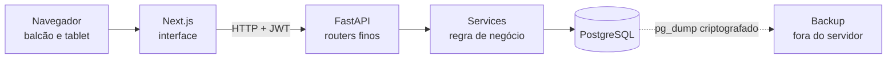

# RotaVenda

Sistema web de vendas e controle de fiado de uma loja de produtos de limpeza, feito para substituir os cadernos de papel.
Em uso numa loja desde julho de 2026, no balcão e na rota. Desenvolvido por mim, de ponta a ponta.

O código é privado porque contém dados de clientes. Mostro o sistema funcionando numa conversa.
Case: [ednan.page/cases/rota](https://ednan.page/cases/rota/)

## Arquitetura

Monólito em camadas: o router recebe e valida, o service decide, o model grava. Uma loja, um banco.

## O problema

A loja vende a maior parte a prazo, no fiado. As vendas ficavam divididas entre um sistema antigo,
planilhas e cadernos de papel, e não havia controle consolidado do que estava a receber. Cada valor
errado é uma cobrança errada para uma pessoa real.

Hoje o total a receber confere ao centavo com a soma das vendas e dos pagamentos.

## Três decisões e o que cada uma custa

**1. O saldo do cliente é calculado, nunca gravado.**
Não existe coluna de saldo. Uma única função calcula débito menos crédito, e extrato, lista de
clientes, rota e relatórios usam essa mesma função. Assim nenhuma tela mostra um número diferente
de outra.
*Custo:* toda leitura paga uma agregação. Resolvi com consultas agregadas em lote, sem uma consulta
por cliente. Se o volume crescer muito, vai precisar de cache por cima, sem substituir o cálculo.

**2. Idempotência nas escritas financeiras.**
Venda, pagamento, compra e conta a pagar aceitam uma chave `Idempotency-Key`, guardada com unicidade
no banco. Se a conexão cai e a pessoa toca de novo, a segunda requisição não cria outro lançamento.
Quem garante é o índice único, não uma consulta antes de inserir.
*Custo:* uma tabela a mais, e o front precisa gerar uma chave nova a cada envio.

**3. Histórico que não se apaga.**
Toda alteração sensível grava uma linha na trilha de auditoria, com o antes e o depois, e essa
tabela só recebe inserções. Venda, pagamento e cliente usam exclusão lógica. Estorno de pagamento
desfaz a alocação nas parcelas, mas deixa o registro.
*Custo:* as tabelas só crescem, e toda consulta precisa filtrar o que está inativo.

## Onde entra a IA e onde ela para

**Migração dos cadernos (concluída).** Os cadernos de fiado foram fotografados folha a folha. Usei
LLM multimodal para transcrever as fotos e construí a esteira de conferência e importação:

- A leitura vai para tabelas separadas, longe de clientes e vendas. A IA nunca grava no destino.
- Uma tela mostra a foto da folha ao lado do que foi lido. A pessoa aprova, corrige, exclui ou comenta.
- A correção fica ao lado da leitura original, que nunca é sobrescrita.
- Conta rasurada demais fica em branco e marcada para revisão, em vez de ganhar um valor estimado.
- A importação só aceita o que foi aprovado e roda em simulação até ser confirmada.

Mais de 200 folhas passaram pela esteira. Case: [ednan.page/cases/rota-migracao](https://ednan.page/cases/rota-migracao/)

**Assistente de consulta.** O gerente pergunta com as próprias palavras e recebe rankings, séries
e listas com os mesmos números das telas. O assistente só lê: usa LangGraph e tool calling sobre os
mesmos services dos relatórios, então o número é o da tela. Uma guarda descarta a resposta se ela
citar valor em R$ ou percentual que não veio das consultas, e há teto de custo por usuário e por mês.

## Stack

| Camada | Tecnologias |
| --- | --- |
| Back-end | Python 3.11, FastAPI, SQLAlchemy 2 (síncrono), Alembic, Pydantic |
| Banco | PostgreSQL 16, busca sem acento com `unaccent` e `pg_trgm` |
| Front-end | Next.js 15 (App Router), React 19, TypeScript, Tailwind, TanStack Query, react-hook-form, Zod |
| Documentos | PDF com reportlab, Excel com openpyxl |
| Segurança | JWT, refresh em cookie httpOnly, bcrypt, papéis ADMIN, GERENTE e VENDEDOR checados no back-end, rate limit no login |
| Testes e CI | pytest contra PostgreSQL real, cada teste numa transação revertida; GitHub Actions com black, isort, migrations, pytest e build do front |
| Infra | Docker Compose em VPS único; backup com `pg_dump`, GPG e envio para a nuvem |

## Limites

- Não há testes automatizados de front-end. A interface é validada manualmente.
- O recibo pelo WhatsApp é um link `wa.me` montado no front, não integração por API. PIX é só uma forma de pagamento registrada, sem gateway.
- Observabilidade básica: `/health` que testa o banco, versão do build exposta e trilha de auditoria. Sem métricas nem logs estruturados.
- A última etapa da migração dos cadernos era manual e exigia alguém técnico.

## Links

- [ednan.page](https://ednan.page)
- ednanferreira.dev@gmail.com
